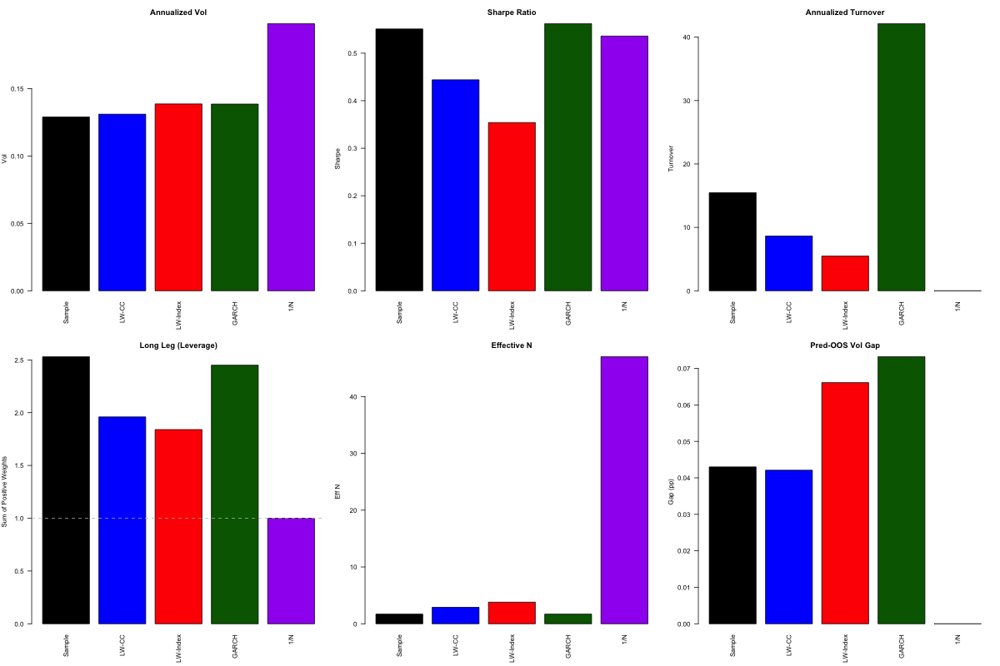
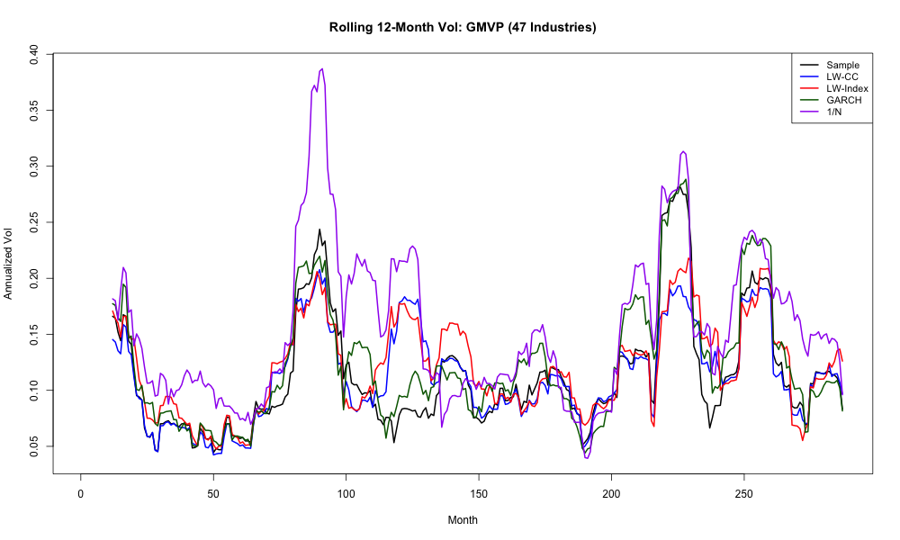
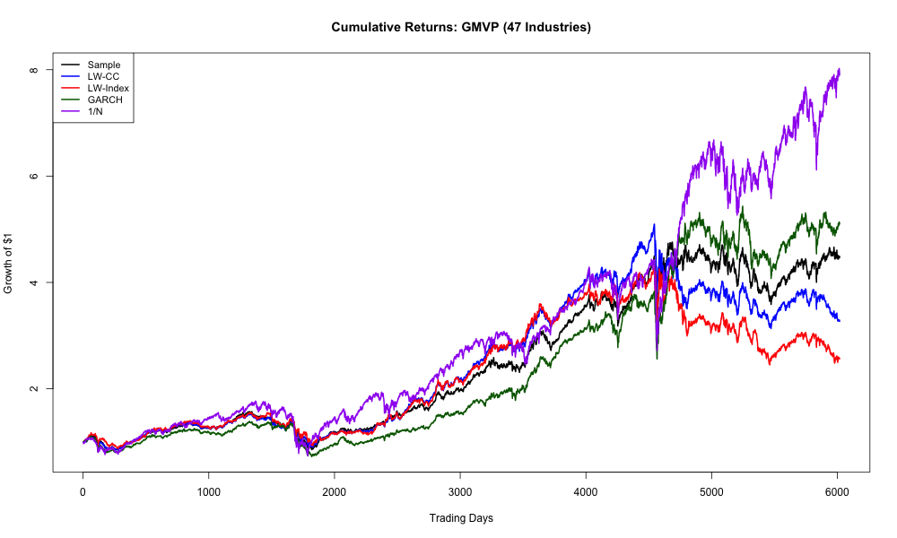
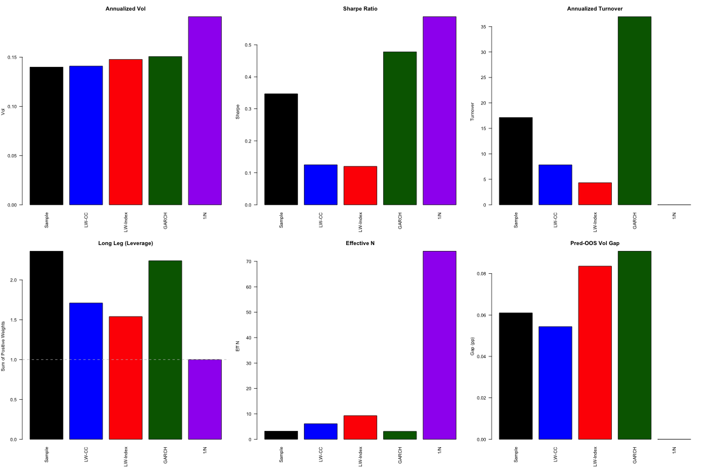
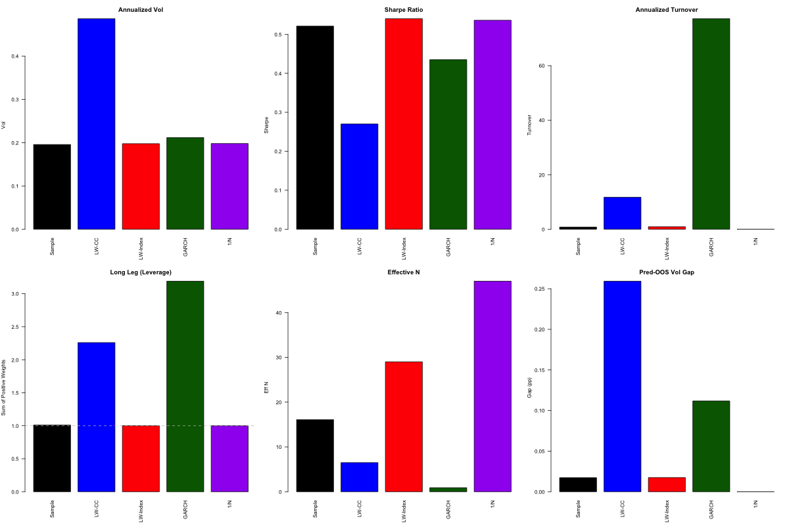

# Shrinkage Estimators for the Covariance Matrix — MF825 Portfolio Construction

One-line description: backtest whether Ledoit-Wolf shrinkage and GARCH
covariance estimates build better minimum-variance and max beta/vol
portfolios than the plain sample covariance, on the 47 Fama-French
industries and 74 large-cap US stocks (2001–2025).

## TL;DR
- Realized volatility hardly changes from one estimator to the next. Every
  GMVP lands around **13–15% annualized**, compared with **~19–20% for 1/N**.
  The minimum-variance idea works, but the covariance estimator matters
  less than I expected.
- What shrinkage really buys is **stability**. LW-CC and LW-Index cut annual
  turnover by about 2–3x compared with the sample covariance (roughly 15x
  down to 5–9x on industries), lower leverage, and spread the weights out
  (higher effective N).
- GARCH has the best Sharpe among the optimized GMVPs, but it trades
  **~40x a year**. After costs it probably wins nothing.
- On single stocks, **1/N has the best Sharpe**. That is DeMiguel, Garlappi & Uppal
  (2009) all over again.
- Every estimator **under-predicts** out-of-sample vol, by about 4–9 pp. The
  covariance forecast from the in-sample window is always too optimistic.

## Methodology

### Data
- **47 Industries:** daily Fama-French 47 industry portfolios (`data/47indus-day.csv`),
  2001-01-02 to 2025-12-31, converted to excess returns over RF. The market
  factor `RmRF` from the same file is the index for betas.
- **74 Stocks:** daily returns of 74 large-cap US names (AAPL, JPM, KO, MSFT and
  similar blue chips, full list in `data/tickers.txt`), aligned to the French file's trading days and converted to
  excess returns the same way. The file isn't in the repo (see [Reproducing](#reproducing)).

### Backtest
- Rolling **252-day** estimation window, **monthly** rebalance on the first
  trading day of each month, held until the next rebalance.
- Two portfolios per estimator:
  - **GMVP:** w ∝ Σ̂⁻¹·1
  - **Max beta/vol:** w ∝ Σ̂⁻¹·β, with β estimated against the market over the same window
- Shorts are unconstrained and weights sum to 1.
- Turnover is measured against **drifted** weights (what the portfolio
  actually holds right before the trade), not against last month's targets.
- Benchmark: **1/N**, rebalanced monthly.

### Covariance estimators (`03_estimators.R`)
| Name | What it is |
|---|---|
| Sample | `cov(R)` |
| LW-CC | Ledoit-Wolf shrinkage toward a constant-correlation target |
| LW-Index | Ledoit-Wolf shrinkage toward the single-index model F = σ²ₘββ' + D_ε |
| GARCH | Univariate GARCH(1,1) one-step variance per asset (`rugarch`), combined with the static sample correlation matrix |

Both LW versions use the same shrinkage intensity:

δ̂ = α̂² / (α̂² + β̂²), clipped to [0, 1]

α̂² is the estimation noise in S and β̂² is the bias-corrected
distance ‖F − S‖². The result is Σ̂ = δ̂F + (1 − δ̂)S. If GARCH fails to
converge for an asset, I fall back to that asset's sample variance.

### Evaluation (`02_backtest.R`, `04_tests.R`, `05_results.R`)
- Annualized mean, vol, Sharpe
- Predicted vs realized vol gap (does the estimator know how risky its own portfolio is?)
- Turnover, long leg (sum of positive weights, i.e. leverage), max weight, effective N = 1/Σw²
- **Tests:** paired t-test on daily squared returns (equal variance?),
  block bootstrap CIs (6-month blocks, 1000 draws), and the Ledoit-Wolf
  Sharpe ratio equality test via `PeerPerformance`
- **Crisis windows:** Dot-Com (2001–02), GFC (Sep 2008 – Mar 2009), COVID (Feb–Mar 2020)

## Results

### GMVP — 47 Industries


All four estimators sit at ~13–14% vol. Sample and GARCH stack up the most
leverage (long leg ~2.5) and the least diversification (effective N under 2),
which is the classic error-maximization problem with an unshrunk Σ̂⁻¹.
Shrinkage brings both down, at the cost of a slightly lower Sharpe here.



The gap matters most in the stress periods. During the GFC and COVID, 1/N
peaks near 39% and 31% rolling vol, while the GMVPs stay well below it.



### GMVP — 74 Stocks


Same story on vol. On Sharpe, the shrinkage estimators fall to ~0.12 and
1/N comes out on top at ~0.58. The forecast error is also larger with
more assets (the pred-OOS gap reaches 6–9 pp).

### Max beta/vol — 47 Industries


This one is unstable. LW-CC blows up to ~48% vol with a 26 pp forecast
miss, and GARCH runs a long leg of ~3x and turnover above 70x. The
Σ̂⁻¹β direction is much more sensitive to estimation error than Σ̂⁻¹1.
LW-Index is the only optimized version that stays sensible.

Plots of rolling returns and rolling vol for the stock universe are also in `output/`.

## Reproducing
```bash
git clone https://github.com/no-322/covariance-shrinkage.git
cd covariance-shrinkage
Rscript -e 'install.packages(c("rugarch", "PeerPerformance"))'
```
Then, in an R session started from the repo root:
```r
source("00_run_all.R")              # backtests + tables + tests (GARCH is slow, expect a while)
source("06_generate_all_outputs.R") # all tables, crisis analysis and plots -> output/
```
**Stock data:** `01b_load_stocks.R` expects `data/stock_returns_clean.csv`.
That's a `date` column (YYYYMMDD) plus one column per ticker, holding daily
returns in **percent**. I left it out because of data licensing. The tickers are listed in
`data/tickers.txt`. Build it from CRSP or any other source, or use your own universe. If you only want the industries, comment out the
stock sections in `00_run_all.R`.

## Repo structure
```
.
├── 00_run_all.R               # master script
├── 01_load_data.R             # FF 47 industries -> excess returns, mkt, year-month
├── 01b_load_stocks.R          # stock universe, aligned to FF dates
├── 02_backtest.R              # rolling GMVP / max beta-vol backtest, 1/N, summary metrics
├── 03_estimators.R            # LW-CC, LW-Index, GARCH covariance
├── 04_tests.R                 # paired var test, block bootstrap, Sharpe equality
├── 05_results.R               # tables, crisis analysis, plots
├── 06_generate_all_outputs.R  # writes everything to output/
├── data/
│   ├── 47indus-day.csv
│   └── tickers.txt            # stock universe (returns file not included)
└── output/                    # charts
```

## Honest limitations
- **GARCH here is not a real multivariate model.** The variances move over
  time but the correlations are static sample ones. That's why it doesn't
  help the forecast gap at all.
- **No constraints.** Unconstrained shorts mean long legs of 2–3x, and
  nobody would run that in practice.
- **No transaction costs.** The Sharpe ranking would change once GARCH's
  turnover is charged for.
- **Survivorship bias** in the stock list. These are today's large caps, picked in hindsight.
- I chose the crisis windows after already knowing the history, so the
  crisis analysis is descriptive, not a test.

## What I'd do differently
- Use DCC-GARCH, so correlations also move in a crisis (and that's when they move most).
- Try Ledoit-Wolf (2017) **nonlinear** shrinkage instead of a single linear δ.
- Add long-only and turnover-penalized versions and report Sharpe net of costs.
- Pick the window length (252 days) by validation instead of convention.
